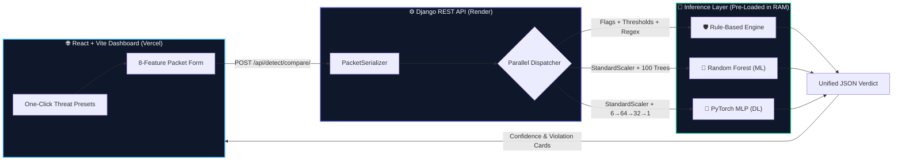
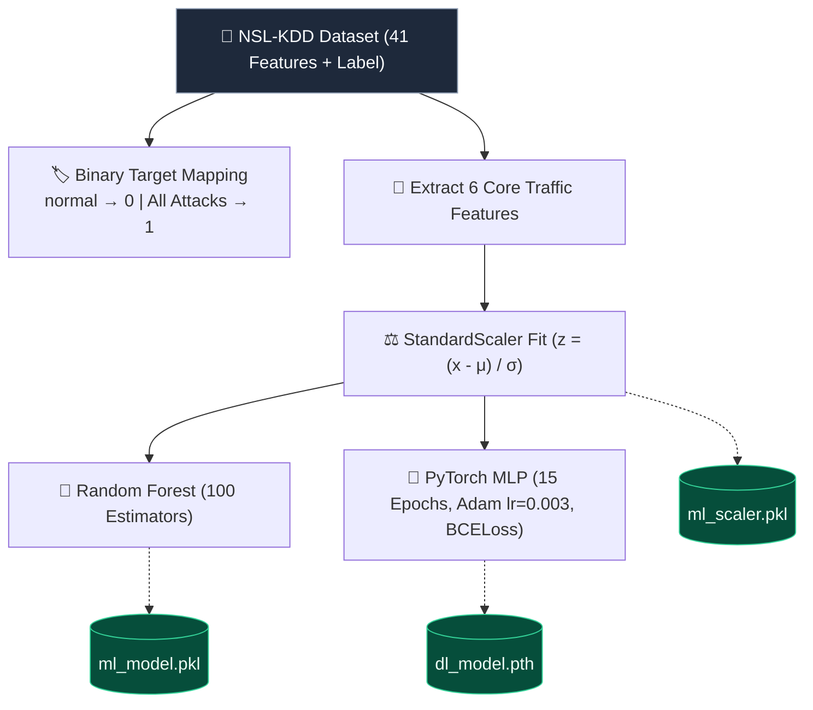

<div align="center">

# 🛡️ OmniDefense IDS
### Multi-Paradigm Network Intrusion Detection & Threat Analysis Gateway

*Real-time cyber threat evaluation combining Deterministic Heuristics, Random Forest Machine Learning, and PyTorch Deep Learning in a unified diagnostic platform.*

<p>
  
  
  
  
  
  
</p>

<p>
  <a href="https://ids-project-jet.vercel.app/"><strong>🌐 Live Project Interface</strong></a> •
  <a href="#-system-architecture"><strong>🏗️ Architecture</strong></a> •
  <a href="#-detection-engines"><strong>🧠 Detection Engines</strong></a> •
  <a href="#-packet-parameters"><strong>🎛️ Parameters</strong></a> •
  <a href="#-quick-start"><strong>🚀 Quick Start</strong></a>
</p>

</div>

---

## 📖 Why OmniDefense IDS?

Single-paradigm Intrusion Detection Systems always leave a blind spot:

<table>
  <tr>
    <td width="50%" valign="top">
      <h3>🔍 Signature & Rule Engines</h3>
      <ul>
        <li><strong>Strength:</strong> 100% deterministic accuracy on explicit payload exploits (SQL Injection, XSS, Path Traversal).</li>
        <li><strong>Blind Spot:</strong> Easily bypassed by novel, zero-day, or statistical volumetric anomalies that avoid static thresholds.</li>
      </ul>
    </td>
    <td width="50%" valign="top">
      <h3>🤖 Machine & Deep Learning</h3>
      <ul>
        <li><strong>Strength:</strong> Uncovers complex statistical anomalies (SYN Floods, Port Scans) across traffic flow metrics.</li>
        <li><strong>Blind Spot:</strong> Blind to malicious strings hidden inside normal-looking HTTP sessions.</li>
      </ul>
    </td>
  </tr>
</table>

> **💡 The OmniDefense Solution:** Every submitted network connection vector is evaluated **simultaneously across all three engines**. Security analysts get a side-by-side diagnostic breakdown showing confidence percentages, raw attack probabilities, and exact rule violations in milliseconds.

---

## 🏗️ System Architecture



---

## 🧠 Detection Engines

| Paradigm | Engine | Technical Implementation | Input Scope | Best At Catching |
| :--- | :--- | :--- | :--- | :--- |
| **Deterministic** | **Rule-Based IDS** | Heuristic thresholds + Compiled Regex (`re`) | **All 8 features** (`flag`, `payload` text, thresholds) | SQLi, XSS, Directory Traversal, Brute-Force |
| **Machine Learning** | **Random Forest** | 100 CART Trees (`max_depth=10`, Gini impurity) | **6 scaled numerical features** | Volumetric DoS, Port Scans, Flow Anomalies |
| **Deep Learning** | **PyTorch MLP** | `Linear(6→64→32→1)` + `BatchNorm` + `Dropout(0.2)` + `Sigmoid` | **6 scaled numerical features** | Non-linear multi-feature intrusion patterns |

### 🔬 Real-World Hybrid Example: SQL Injection
When an attacker sends `SELECT * FROM users UNION SELECT username, password FROM accounts;`, the underlying TCP handshake looks completely normal (`flag: SF`, `serror_rate: 0.0`, `duration: 0.8s`):
* **Random Forest & PyTorch MLP** $\rightarrow$ Predict **`Normal`** (network flow statistics are healthy).
* **Rule-Based Engine** $\rightarrow$ Predicts **`Attack`** (`100%` confidence, matches `UNION SELECT` payload signature).

---

## 📊 Dataset & Offline Training Pipeline

Both ML and DL models are trained on the benchmark **NSL-KDD** dataset (`KDDTrain+.txt` — **125,973** records; `KDDTest+.txt` — **22,544** records) covering **DoS**, **Probe**, **R2L**, and **U2R** attack families:



---

## 🎛️ Packet Parameters

Every evaluation accepts an 8-field JSON vector representing a network session:

| Parameter | Type | Valid Range | Security Role & Threat Indicators |
| :--- | :--- | :--- | :--- |
| `duration` | `Float` | `0.0+` sec | Connection length. `0.0` signals rapid automated floods or probes. |
| `src_bytes` | `Integer` | `0+` bytes | Client $\rightarrow$ Server bytes. `0` = empty probe; `> 5,000,000` = data exfiltration. |
| `dst_bytes` | `Integer` | `0+` bytes | Server $\rightarrow$ Client bytes. `0` indicates unanswered or dropped packets. |
| `failed_logins` | `Integer` | `0+` count | Failed authentication attempts. `>= 3` triggers Brute-Force alerts. |
| `same_srv_rate` | `Float` | `0.0 – 1.0` | Ratio of connections to the same port/service. `< 0.1` indicates multi-port scanning. |
| `serror_rate` | `Float` | `0.0 – 1.0` | Ratio of connections with TCP `SYN` errors. `> 0.7` signals a **SYN Flood DoS**. |
| `flag` | `String` | `SF`, `S0`, `REJ`, `RSTOS0` | TCP state (`SF` = Normal, `S0` = Half-open SYN flood, `REJ` = Rejected, `RSTOS0` = Reset scan). |
| `payload` | `String` | Any text | Application payload scanned via Regex for SQLi, XSS (`<script>`), `../`, and `/bin/sh`. |

---

## 🧪 Built-In Simulation Presets

Use the header buttons in the dashboard to load pre-configured threat scenarios:

| Preset | Key Vector Characteristics | Rule Engine | Random Forest | PyTorch MLP |
| :--- | :--- | :---: | :---: | :---: |
| 🟢 **NORMAL** | `duration: 1.5`, `src_bytes: 1040`, `dst_bytes: 4200`, `flag: SF` | `Normal` | `Normal` | `Normal` |
| 🔴 **SYN FLOOD** | `duration: 0.0`, `src_bytes: 0`, `serror_rate: 0.95`, `flag: S0` | `Attack` | `Attack` | `Attack` |
| 🟠 **BRUTE FORCE** | `duration: 12.0`, `failed_logins: 6`, `flag: SF` | `Attack` | `Attack` | `Attack` |
| 🟡 **SQLI** | `duration: 0.8`, `flag: SF`, `payload: ... UNION SELECT ...` | `Attack` | `Normal` | `Normal` |

---

## 🔌 REST API Reference

**Primary Endpoint:** `POST /api/detect/compare/`  
*(Single-engine endpoints: `POST /api/detect/rule/`, `POST /api/detect/ml/`, `POST /api/detect/dl/`)*

<details>
<summary><strong>Click to view Sample Request & Response JSON</strong></summary>

#### Request Body
```json
{
  "duration": 0.0,
  "src_bytes": 0,
  "dst_bytes": 0,
  "failed_logins": 0,
  "same_srv_rate": 0.05,
  "serror_rate": 0.95,
  "flag": "S0",
  "payload": ""
}
```

#### Response (`200 OK`)
```json
{
  "rule_based": {
    "prediction": "Attack",
    "anomaly_detected": true,
    "confidence": 1.0,
    "violations": [
      "SYN Flood / DoS indicator: flag=S0, serror_rate=0.95.",
      "Port scan probe: low service affinity with zero payload bytes."
    ],
    "method": "Rule-Based Engine"
  },
  "machine_learning": {
    "prediction": "Attack",
    "anomaly_detected": true,
    "confidence": 0.9912,
    "attack_probability": 0.9912,
    "method": "Machine Learning (Random Forest)"
  },
  "deep_learning": {
    "prediction": "Attack",
    "anomaly_detected": true,
    "confidence": 0.9984,
    "attack_probability": 0.9984,
    "method": "Deep Learning (PyTorch MLP)"
  }
}
```
</details>

---

## 📁 Project Structure

```text
IDS/
├── backend/
│   ├── detection/
│   │   ├── artifacts/          # Pre-trained ml_model.pkl, ml_scaler.pkl & dl_model.pth
│   │   ├── engines/
│   │   │   ├── rule_based.py   # Threshold & regex signature engine
│   │   │   ├── ml_engine.py    # Scikit-Learn Random Forest wrapper
│   │   │   └── dl_engine.py    # PyTorch MLP inference wrapper
│   │   ├── serializers.py      # DRF input validation
│   │   ├── views.py            # REST API views
│   │   └── urls.py             # API route definitions
│   ├── ids_backend/            # Django settings, CORS & root URLs
│   ├── train_models.py         # Offline NSL-KDD training pipeline
│   └── requirements.txt        # CPU-only PyTorch & Django dependencies
└── frontend/
    ├── src/
    │   ├── components/         # Header, EngineSelector, PacketInputForm, ResultsContainer, DiagnosticCard
    │   ├── constants/          # Attack simulation presets
    │   └── App.jsx             # Root state & API integration
    └── package.json
```

---

## 🚀 Quick Start

### 1. Run the Backend Locally
```bash
cd backend
python -m venv venv
# Windows: venv\Scripts\activate  |  macOS/Linux: source venv/bin/activate

pip install -r requirements.txt
python manage.py migrate
python manage.py runserver
```

### 2. Run the Frontend Locally
```bash
cd frontend
npm install
echo "VITE_API_URL=http://127.0.0.1:8000" > .env
npm run dev
```

---

## ☁️ Production Deployment Architecture

* **Backend (Render):** Deployed from `backend/` using CPU-only PyTorch wheels (`--extra-index-url https://download.pytorch.org/whl/cpu`) and pre-trained model artifacts so runtime RAM stays comfortably within Render's **512 MiB** free tier:
  ```bash
  python manage.py migrate && python -m gunicorn ids_backend.wsgi:application --bind 0.0.0.0:$PORT --workers 1 --threads 2
  ```
* **Frontend (Vercel):** Deployed from `frontend/` as a static Vite build (`npm run build` $\rightarrow$ `dist`) with `VITE_API_URL` configured to `https://ids-project-final.onrender.com`.
